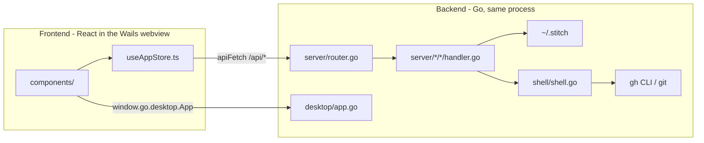

# Stitch 🧵

[](../../issues?q=is%3Aopen+label%3Ahacktoberfest)
[](../../issues?q=is%3Aopen+label%3A%22good+first+issue%22)

Stitch is a productivity-first desktop app that groups and manages your GitHub repositories (both local clones and web-only remotes) by your active energy level (Low, Medium, High).

It aggregates issues, PR reviews, tag releases, and build states into a single workspace, using the official GitHub CLI (`gh`) under the hood so credentials stay secure and local.

> 🎃 **Hacktoberfest**: Stitch is open for contributions! Check the [`good first issue`](../../issues?q=is%3Aopen+label%3A%22good+first+issue%22) label to get started. Read [CONTRIBUTING.md](./CONTRIBUTING.md) for guidelines.

---

## Features

### 🏠 Home Overview
Aggregates all tracked repos into a single dashboard — total repo count, open PRs, open issues, day streak, local vs. web breakdown, and a live GitHub contribution graph.

### 📁 Repositories Workspace
Add local repo directories or web-only GitHub remotes. Toggle focus tags, star primary projects, and manage your tracked repo list.

### ⚡ Energy-Guided Navigation
A floating panel lets you switch between three energy modes that filter which tabs are visible:

| Mode | Tabs shown |
|------|-----------|
| **Low** | PR Reviews · Issues |
| **Medium** | Releases · Major Projects |
| **High** | Focus Workspace · Builds |

### 🎯 Focus Workspace
Deep-work mode for your currently focused repo. Includes:
- **File explorer** — browse local or remote repo contents and view file contents inline.
- **Architecture Diagram** — interactive node-edge canvas (powered by React Flow) to sketch and persist your repo's architecture.
- **Focus Checklist** — per-project task list persisted to `localStorage`.
- **Focus Scratchpad** — freeform markdown notes scoped to the active project.
- **Pomodoro Timer** — 25/5/15 work-break cycles with chime, session counter, and `localStorage` persistence.
- **Build Runner** — stream live build/lint output from the repo's configured scripts.

### ⭐ Major Projects Deep-Dive
Clicking a starred project opens a detail workspace partitioning features, bugs, reviews, issues, and a remote-synced roadmap. Includes an **Ideas Editor** — a markdown file manager that reads and writes `.md` files directly from the repo via the GitHub API.

### 🗺️ Remote Roadmap Sync
Roadmap items are saved to and read from a GitHub issue tagged with the label `roadmap`. The label and issue are automatically created on the remote if they don't exist.

### 📦 Releases
View tag releases across all tracked repos. Cut a new release (tag + notes) directly from the UI.

### 🤖 AI Provider Monitor
Inspect and clean up disk usage from local AI tool caches (Gemini, Claude, OpenAI, Anthropic, Cursor) — screenshots, recordings, and media stored under `~/.<provider>`.

### 👤 Developer Profile
Configure global Git properties (`user.name`, `user.email`) and run environment runtime checks (Go, Node, Python, Postgres, Redis) and macOS diagnostics from one screen.

---

## Architecture

```
stitch/
  backend/                   ← Go backend + Wails desktop shell
    main.go                  ← Entrypoint: starts the desktop app
    internal/
      config/                ← config.json read/write + ~/.stitch data dir
      models/                ← Shared struct types (Repo, Config)
      shell/                 ← exec.Command wrapper + Git/gh CLI helpers
      build/                 ← build/lint runner (streams output as Wails events)
      server/                ← /api handlers, served in-process to the webview
        router.go            ← Route registration
        repos/               ← CRUD + toggle-major + set-focus + tab-energies
        contributions/       ← PRs, issues, GitHub contribution graph
        focus/               ← Focus repo info + file contents
        ideas/               ← Markdown ideas file CRUD
        plans/               ← Plans CRUD + promote
        releases/            ← Tag listing + release creation
        roadmap/             ← Remote roadmap issue sync
        monitor/             ← AI provider disk usage + cleanup
        profile/             ← Git config read/write
      desktop/               ← Wails app bootstrap + JS bindings (app.go)
  client/                    ← Vite + React 19 + TypeScript frontend
    src/
      store/useAppStore.ts   ← Zustand global state + apiFetch
      lib/desktop.ts         ← Helpers for the Go bindings (builds, file saves)
      components/            ← Tab panels & UI elements
        focus/               ← PomodoroTimer, FocusChecklist, FocusScratchpad,
                                ArchitectureDiagram (React Flow)
        ui/                  ← shadcn/ui primitives + Badge, EmptyState, StatCard
        layout/              ← PageHeader, NavList, EnergyPanel, ConfirmDialog, ...
      styles/tailwind.css    ← Tailwind v4 + theme tokens
```

### How the layers connect



Stitch is a desktop-only app. The Wails webview loads the UI from assets embedded in the binary and sends `/api/*` requests straight to the Go handlers in the same process, so no network port is opened. Native features (folder picker, save dialog, opening links, live build output) go through the bindings in `desktop/app.go`.

User data (tracked repos, planner, diagrams, ideas for web-only repos) lives in `~/.stitch`. A `config.json` or `focus.json` from an older version, left in `backend/` or the repo root, is copied there on first run.

---

## Setup & Running

### Prerequisites

- **Go 1.25+**
- **Node.js 20+**
- **Wails v2.17.0** (see below)
- **GitHub CLI** installed and authenticated:

```bash
gh --version
gh auth login
```

### 1. Clone & Install

```bash
git clone https://github.com/manas2297/stitch.git
cd stitch
npm install
```

Go modules are downloaded automatically on the first build — no separate `go mod tidy` is needed.

### 2. Install Wails

Use the version pinned in `backend/go.mod` so `wails dev` doesn't rewrite `go.mod`/`go.sum`:

```bash
go install github.com/wailsapp/wails/v2/cmd/wails@v2.17.0
```

Make sure Go's bin directory is on your `PATH` (add this to your shell profile if `wails` isn't found):

```bash
export PATH="$PATH:$(go env GOPATH)/bin"
wails doctor   # verifies your system is ready
```

> If you previously installed Wails on a different CPU architecture (e.g. an x86_64 binary on Apple Silicon, which fails with `bad CPU type in executable`), re-run the `go install` command above.

### 3. Run in dev mode (live-reload window)

```bash
npm run dev
```

This opens the Stitch window with Vite HMR for the UI and rebuilds Go on change. Wails also serves the app at `http://localhost:34115` if you want browser devtools.

### 4. Build the app

```bash
npm run build
```

Output: **`backend/build/bin/Stitch.app`** on macOS (`Stitch.exe` on Windows).

### Tests

```bash
npm test   # go test ./... in backend/
```

---

## Tech Stack

| Layer | Technology |
|-------|-----------|
| Frontend | React 19, TypeScript, Vite, Zustand |
| UI components | [shadcn/ui](https://ui.shadcn.com/) (Radix + Tailwind CSS v4), [Sonner](https://sonner.emilkowal.ski/) toasts, [lucide-react](https://lucide.dev/) icons |
| Diagrams | [@xyflow/react](https://reactflow.dev/) (React Flow) |
| Backend | Go 1.25+ |
| Desktop | [Wails v2](https://wails.io/) |
| Dev hot-reload | `wails dev` (Go), Vite HMR (React) |
| Auth / GitHub API | [GitHub CLI (`gh`)](https://cli.github.com/) |
| Local Git | `git` CLI |

---

## Contributing

Contributions are welcome! Please read [CONTRIBUTING.md](./CONTRIBUTING.md) before opening a pull request.

- Browse open [`good first issue`](../../issues?q=is%3Aopen+label%3A%22good+first+issue%22) tasks.
- Use the issue templates when reporting bugs or proposing features.
- All PRs must be linked to an open issue.
